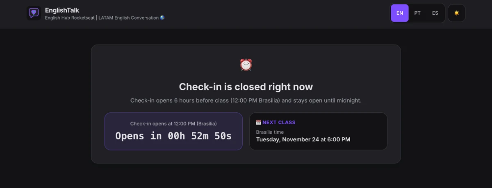
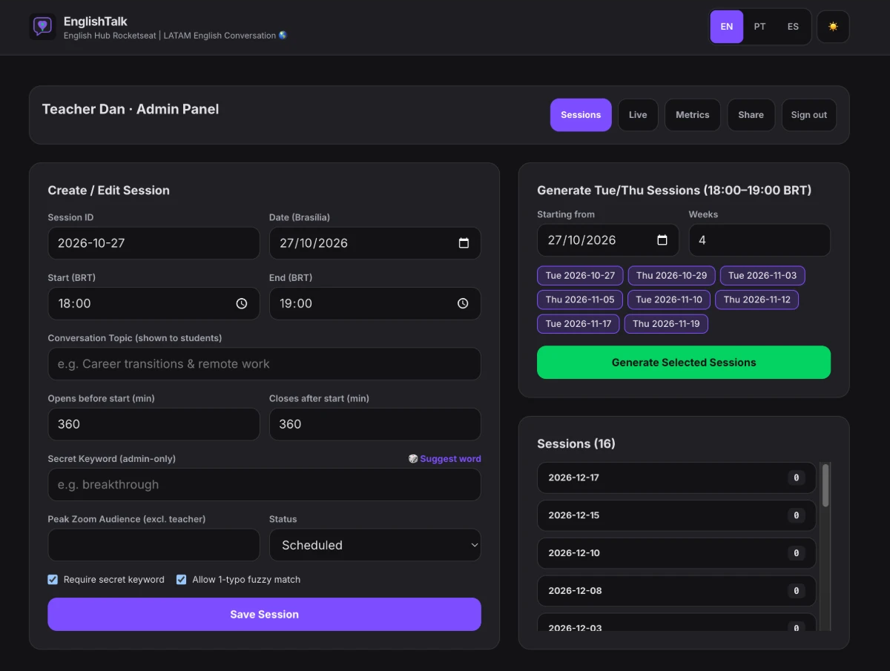
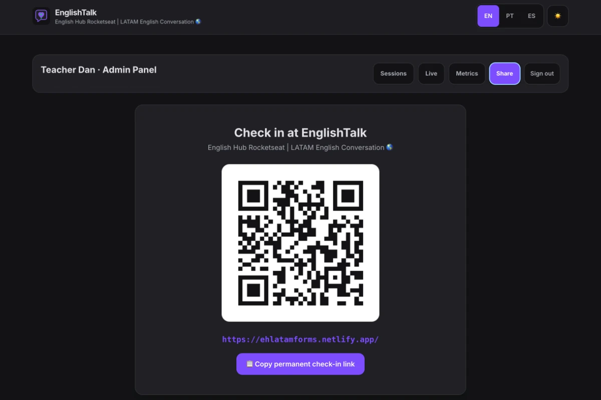
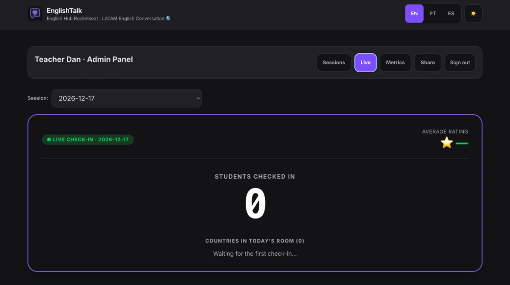
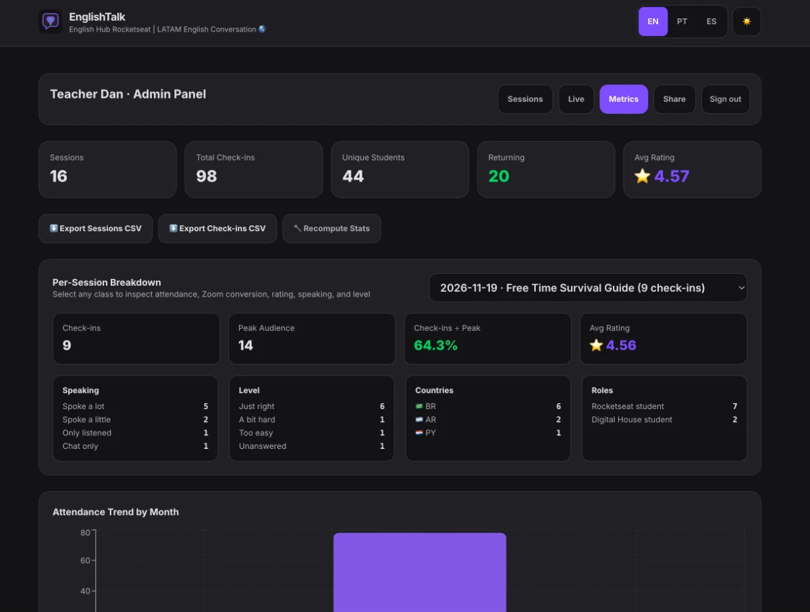

<div align="center">


# EnglishTalk 🌎

### Show up. Speak up. Level up your English.

The check-in app for the **English Hub Rocketseat | LATAM English Conversation** live classes.<br/>
Mobile-first · Trilingual (EN / PT-BR / ES) · Works offline · Installable like a native app

[](https://ehlatamforms.netlify.app/)

[](https://react.dev/)
[](https://www.typescriptlang.org/)
[](https://vite.dev/)
[](https://tailwindcss.com/)
[](https://firebase.google.com/)
[](https://www.netlify.com/)
[](https://web.dev/progressive-web-apps/)
[](https://playwright.dev/)
[](https://vitest.dev/)
[](https://pnpm.io/)
[](https://github.com/dequelabs/axe-core)

</div>

---

# Part 1 · The fun part 🎉

## What is this?

Twice a week, **Teacher Dan** hosts a live, online **English conversation class** for the Rocketseat and Digital House community across Latin America. No slides to memorize, no pressure: you show up, you talk, you get more comfortable speaking English with people who are learning just like you.

**EnglishTalk** is the little app that makes those classes run smoothly. It replaced the old Google Form and grew into something much nicer:

- ✅ **Check in with 3 quick steps** from your phone: tell us who you are, how class went, and the secret word.
- 🔥 **Build a streak.** Come to class again and again and watch your attendance flame grow.
- 💬 **Have a say.** Rate the class, tell us if the level felt right, leave a comment and suggest topics you want to talk about.
- 🌎 **Speak your language.** The app is available in English, Portuguese and Spanish.
- 📶 **No signal? No problem.** If your connection drops, your check-in is saved on your phone and sent when you are back online.
- 📱 **Install it.** Add it to your home screen and it opens like any other app.

## The classes 🗣️

|             |                                                                                |
| ----------- | ------------------------------------------------------------------------------ |
| **What**    | Live English **conversation** class, focused on speaking                       |
| **When**    | **Tuesdays and Thursdays**, **18:00 to 19:00** (Brasília time, UTC−3)          |
| **Where**   | Online, live on Zoom (the link is shared with the community)                   |
| **Who**     | Rocketseat and Digital House students, team and guests from all over **LATAM** |
| **Teacher** | Teacher Dan                                                                    |

### Why join?

- **Speaking is a muscle.** Reading and listening are not enough. Here you actually talk.
- **It is friendly.** Mistakes are welcome. Talking a little counts, and so does just listening while you warm up.
- **Your topics matter.** Students suggest what we talk about, and class feedback shapes the next sessions.
- **It fits your week.** Two evenings, one hour each, with a check-in that takes about a minute.

## How check-in works (for students)

1. **Scan the QR code** shown in class (or open the permanent link).
2. **Answer 3 quick steps:** about you, about your class, and the **secret keyword** the teacher says at the end of the lesson.
3. **Done.** Your attendance is recorded and your streak grows. 🔥

> The check-in opens **6 hours before** class (12:00) and closes **6 hours after** it starts (00:00 Brasília time), so you do not have to rush.

## For the teacher 👩‍🏫👨‍🏫

A private admin area lets the teacher:

- generate the Tuesday and Thursday sessions for the coming weeks;
- set the topic and the secret keyword (with a keyword suggester and a reuse warning);
- show a **QR code** on screen during class;
- open a **live projector view** while students check in;
- see **metrics**: attendance, ratings, level feedback, trends, plus a radar of the topics and improvements students ask for;
- **export a CSV** and fix individual check-ins when needed.

## A quick look 👀

<p align="center">
  
  <br/><sub><b>Student view.</b> Outside the window the app shows a countdown and the next class. Switch between EN, PT and ES at the top.</sub>
</p>

<p align="center">
  
  <br/><sub><b>Sessions.</b> Create a class, set the topic and secret keyword, or generate the next weeks in one click.</sub>
</p>

<p align="center">
  
  <br/><sub><b>Share.</b> One permanent QR code and link, ready to show during class.</sub>
</p>

<p align="center">
  
  <br/><sub><b>Live.</b> Watch check-ins arrive in real time.</sub>
</p>

<p align="center">
  
  <br/><sub><b>Metrics.</b> Attendance, returning students, ratings, speaking time, level feedback, countries and trends.</sub>
</p>

---

# Part 2 · The technical part 🛠️

## Table of contents

- [Overview](#overview)
- [Features](#features)
- [Tech stack and why](#tech-stack-and-why)
- [Architecture](#architecture)
- [Getting started](#getting-started)
- [Scripts](#scripts)
- [Environment variables](#environment-variables)
- [Project structure](#project-structure)
- [How the key pieces work](#how-the-key-pieces-work)
- [Testing and quality](#testing-and-quality)
- [Deployment](#deployment)
- [Security and privacy](#security-and-privacy)
- [Documentation](#documentation)
- [Roadmap](#roadmap)

## Overview

EnglishTalk is a single-page **Progressive Web App** backed by a few **serverless functions** and a **Firestore** database. Students never talk to the database directly: everything goes through a small API, which is what lets us enforce the check-in window, the secret keyword and the rate limits on the server, where they cannot be tampered with.

Production: **https://ehlatamforms.netlify.app/**. It replaced the Google Forms attendance check-in.

## Features

| Area               | What it does                                                                                                                                              |
| ------------------ | --------------------------------------------------------------------------------------------------------------------------------------------------------- |
| **Check-in**       | 3-step flow, one permanent URL and QR code, the open class is detected on the server                                                                      |
| **12-hour window** | Opens 6 h before and closes 6 h after the class start (`America/Sao_Paulo`), configurable per session                                                     |
| **Validation**     | Email typo suggestions (`gmial.com` becomes `gmail.com`), typo-domain blocklist, Gmail dot and `+tag` normalization, one check-in per student per session |
| **Secret keyword** | Checked on the server only; ignores case, accents and hyphens; tolerates one typo (fuzzy)                                                                 |
| **Streaks**        | Returning-student prefill and an attendance streak flame                                                                                                  |
| **Offline**        | IndexedDB queue, auto-flush on reconnect, late submissions accepted for up to 48 h                                                                        |
| **PWA**            | Installable, auto-updating service worker, iOS install instructions                                                                                       |
| **i18n**           | English, Portuguese (BR) and Spanish (LATAM), lazy-loaded, `?lang=` override                                                                              |
| **Admin**          | Google or email-link login, session generator, QR share screen, live projector mode, metrics, topic and improvement radar, CSV export, stats repair       |
| **Accessibility**  | WCAG AA checked with axe in 3 languages, light and dark themes, 200% zoom                                                                                 |

## Tech stack and why

| Technology                                              | Role                     | Why we use it                                                                              |
| ------------------------------------------------------- | ------------------------ | ------------------------------------------------------------------------------------------ |
| **React 19 + TypeScript (strict)**                      | UI and type safety       | Mature ecosystem; strict types catch mistakes before students do                           |
| **Vite 8**                                              | Build and dev server     | Very fast builds and hot reload, first-class PWA plugin                                    |
| **Tailwind CSS 4**                                      | Styling                  | Small CSS output, consistent design tokens (Rocketseat purple and green theme)             |
| **React Router**                                        | Routing                  | `/` check-in, `/privacy`, lazy-loaded `/admin`                                             |
| **React Hook Form + Zod**                               | Forms and validation     | Light forms; the **same Zod schemas run on client and server**, so rules never drift apart |
| **i18next**                                             | Translations             | Lazy per-language catalogs keep the student bundle small                                   |
| **TanStack Query**                                      | Data fetching            | Caching and retries for session data                                                       |
| **Recharts**                                            | Admin charts             | Declarative charts, loaded only on the admin route                                         |
| **Workbox + vite-plugin-pwa**                           | Service worker           | Precaching, update handling and Background Sync with full control (`injectManifest`)       |
| **IndexedDB (`idb`)**                                   | Offline queue            | Survives closing the browser, unlike memory or localStorage                                |
| **Netlify**                                             | Hosting and Functions    | Deploys on every push to `main`, serverless endpoints with built-in rate limiting          |
| **Firebase Firestore**                                  | Database                 | Generous free tier, transactions, real-time updates for the live view, São Paulo region    |
| **Firebase Auth**                                       | Teacher login            | Google or email-link sign-in, only for the admin                                           |
| **Firebase Admin SDK**                                  | Server access            | Functions are the only writers of student data                                             |
| **Firebase App Check**                                  | Bot protection           | reCAPTCHA-based, currently in `soft` mode                                                  |
| **Vitest + Testing Library**                            | Unit tests               | Fast tests for the shared logic                                                            |
| **Firebase Emulators + `@firebase/rules-unit-testing`** | Rules and function tests | Test security rules and endpoints without touching production                              |
| **Playwright + axe-core**                               | E2E and accessibility    | Real mobile and desktop browsers, automated a11y checks                                    |
| **Lighthouse CI**                                       | Performance budgets      | Fails the build if the app gets heavy                                                      |
| **ESLint, Prettier, jsx-a11y**                          | Code quality             | One consistent style and early accessibility warnings                                      |
| **pnpm**                                                | Package manager          | Fast, strict, reproducible installs                                                        |
| **GitHub Actions + Dependabot**                         | CI and updates           | Every push is verified before it matters                                                   |

Native browser APIs do the heavy lifting where possible. For example, time-zone math uses `Intl.DateTimeFormat` instead of a date library, keeping the student bundle small (see [ADR 0003](docs/adr/0003-intl-timezone-handling.md)).

## Architecture

```text
Browser (PWA, React SPA)
   │  GET  /api/sessions/current     public, returns the open class and the server clock
   │  POST /api/checkin              public, rate limited, App Check, keyword verified server-side
   │  admin: Firebase Auth (Google / email link) → Firestore (rules) + admin functions
   ▼
Netlify Functions (Firebase Admin SDK)  ──►  Firestore (southamerica-east1)
```

Core principles:

1. **Students never access Firestore directly.** Security rules deny everything by default; only the teacher can read, and most collections are write-protected even for them.
2. **The server owns the clock.** Whether check-in is open is computed on the server; the client receives `serverNow` so countdowns stay correct even with a wrong phone clock.
3. **The secret keyword never leaves the server.** It lives in an admin-only collection and is compared with a timing-safe hash comparison.
4. **Denormalized aggregates.** Each check-in updates the session stats and the student record in one transaction, so the dashboard reads very little data and stays within free-tier quotas.
5. **Offline first.** Failed submissions go to IndexedDB with a unique id and are retried idempotently.

Details: [docs/ARCHITECTURE.md](docs/ARCHITECTURE.md) and [docs/DATA_MODEL.md](docs/DATA_MODEL.md).

## Getting started

### Prerequisites

- **Node.js 22 or newer** (see `.nvmrc`)
- **pnpm** (`corepack enable` is the easiest way)
- **Java 21**, required by the Firebase emulators

### Run locally

```bash
# 1. Install dependencies
pnpm install

# 2. Start the local Firestore and Auth emulators (terminal 1)
pnpm emulators

# 3. Seed sample sessions into the emulator (terminal 2)
pnpm seed

# 4. Start Vite with Netlify Functions emulation (terminal 2)
pnpm dev
```

The emulators use a demo project, so local development never touches production data.

For `pnpm dev`, create a local `.env` (git-ignored) so the Netlify Functions use the emulators:

```bash
VITE_USE_FIREBASE_EMULATOR=true
FIRESTORE_EMULATOR_HOST=127.0.0.1:8080
FIREBASE_AUTH_EMULATOR_HOST=127.0.0.1:9099
FIREBASE_PROJECT_ID=demo-englishtalk
APP_CHECK_ENFORCEMENT=off
```

The dev server skips the production Content-Security-Policy (it blocks React Fast Refresh); production still enforces it via `netlify.toml`.

## Scripts

| Command                        | Purpose                                                                  |
| ------------------------------ | ------------------------------------------------------------------------ |
| `pnpm dev`                     | Vite dev server with Netlify Functions emulation                         |
| `pnpm build`                   | Typecheck, then bundle the client and the service worker                 |
| `pnpm preview`                 | Serve the production build locally                                       |
| `pnpm test`                    | Unit tests (window, email, keyword, time, schemas, CSV)                  |
| `pnpm test:emulator`           | Firestore rules and Netlify Functions tests on the Firebase Emulator     |
| `pnpm test:e2e`                | Playwright E2E and axe accessibility tests (Pixel 7, iPhone 14, desktop) |
| `pnpm lint`                    | ESLint (flat config, typescript-eslint, jsx-a11y)                        |
| `pnpm typecheck`               | `tsc -b --noEmit`                                                        |
| `pnpm format`                  | Prettier                                                                 |
| `pnpm emulators` / `pnpm seed` | Local Firebase emulators and sample data                                 |
| `pnpm icons`                   | Regenerate PWA icons from `public/logo.svg`                              |
| `pnpm lhci`                    | Lighthouse CI budgets                                                    |

## Environment variables

Copy the names from `.env.example`. **Real values live only in the Netlify dashboard** and must never be committed.

| Variable                                                                                                 | Scope           | Notes                                                          |
| -------------------------------------------------------------------------------------------------------- | --------------- | -------------------------------------------------------------- |
| `VITE_FIREBASE_API_KEY`, `VITE_FIREBASE_AUTH_DOMAIN`, `VITE_FIREBASE_PROJECT_ID`, `VITE_FIREBASE_APP_ID` | Client (public) | Firebase web config; public by design                          |
| `VITE_APPCHECK_SITE_KEY`                                                                                 | Client (public) | reCAPTCHA site key                                             |
| `FIREBASE_PROJECT_ID`, `FIREBASE_CLIENT_EMAIL`, `FIREBASE_PRIVATE_KEY`                                   | Server          | Service account fields; mark the key as **Secret**             |
| `ADMIN_EMAILS`, `VITE_ADMIN_EMAILS`                                                                      | Server / client | Teacher allowlist                                              |
| `SITE_ORIGIN`                                                                                            | Server          | Allowed origin, no trailing slash                              |
| `APP_CHECK_ENFORCEMENT`                                                                                  | Server          | `soft` (default) or strict                                     |
| `HASH_PEPPER`                                                                                            | Server          | Random secret used to hash rate-limit keys; mark as **Secret** |

## Project structure

```text
src/                  React app
  features/checkin    Student 3-step flow, offline queue
  features/admin      Teacher panel, live view, share screen, metrics
  i18n/               en, pt, es catalogs
  lib/                API client, App Check, PWA helpers
  sw.ts               Service worker (Workbox)
netlify/functions/    API endpoints and _lib business logic
shared/               Code shared by client and server (window, email, keyword, time, schemas, CSV)
firebase/             Firestore rules, indexes, emulator tests
e2e/ tests/           Playwright and unit-test setup
docs/                 Plan, architecture, data model, setup guide, ADRs
scripts/              Seed data and icon generation
```

## How the key pieces work

- **Check-in window.** `shared/window.ts` computes `opensAt <= serverNow < closesAt` from the session start and per-session offsets (default 360 minutes each way).
- **Keyword matching.** Normalized (accents, case and hyphens removed), compared by hash in constant time, with an optional Damerau-Levenshtein distance of 1 for keywords of 5 or more characters.
- **Deduplication.** The check-in document id is `{sessionId}__{sha256(canonicalEmail)}`, so one student can only ever have one check-in per session, even if they retry or go offline.
- **Rate limiting.** Netlify's platform limiter plus Firestore `rateLimits` documents keyed by HMAC hashes (raw IPs and emails are never stored), cleaned up by a TTL policy.
- **Offline.** Submissions carry a `clientSubmissionId` and capture time; the queue flushes on `online`, `visibilitychange`, app start and Background Sync.

## Testing and quality

- **Unit tests** for the shared logic (time windows to the second, email and keyword rules, schemas, CSV).
- **Emulator tests** for Firestore security rules and the Netlify Functions.
- **Playwright E2E** on Pixel 7, iPhone 14 and desktop, with **axe-core** accessibility checks.
- **CI** (GitHub Actions) runs audit, typecheck, lint, unit, emulator, build, a **150 KB gzip budget** for the student bundle, E2E and Lighthouse on every push and pull request.

## Deployment

Hosting is on **Netlify**, connected to this GitHub repository:

- A push to `main` builds (`pnpm build`) and publishes `dist/` together with the functions in `netlify/functions/`.
- Security headers (CSP, HSTS and others), caching and the SPA fallback are defined in `netlify.toml`.
- **Firestore rules and indexes are deployed separately**:

  ```bash
  npx firebase-tools deploy --only firestore --config firebase/firebase.json --project <your-firebase-project-id>
  ```

The full first-time setup (Firebase project, Auth, App Check, service account, Netlify variables) is in [docs/SETUP.md](docs/SETUP.md).

## Security and privacy

- Deny-by-default Firestore rules; teacher access is limited to an email allowlist with a verified email.
- Strict Content Security Policy and security headers; source maps are not served publicly.
- Secrets live only in Netlify environment variables; the secret keyword is never sent to clients or logged.
- The app stores each student's **email, country and answers** to track attendance. See the in-app Privacy page. Treat exports and database contents as personal data.

## Documentation

- [Implementation plan](docs/PLAN.md)
- [Setup and deployment guide](docs/SETUP.md)
- [Architecture overview](docs/ARCHITECTURE.md)
- [Firestore data model](docs/DATA_MODEL.md)
- [Trilingual copy review](docs/COPY_REVIEW.md)
- [Architecture decision records](docs/adr/)
- [Source brief](docs/BRIEF.md) and [final report](docs/REPORT.md)

## Roadmap

- 🗳️ Topic voting, so students choose the next class topic
- 🔐 Data retention and deletion policy for student emails (LGPD)
- 🛡️ Move App Check from `soft` to strict enforcement
- 🧪 More tests for streaks and the metrics radar
- 🚀 Migration to the Rocketseat platform

---

<div align="center">

Made with 💜 for the **English Hub Rocketseat | LATAM** community.

</div>
